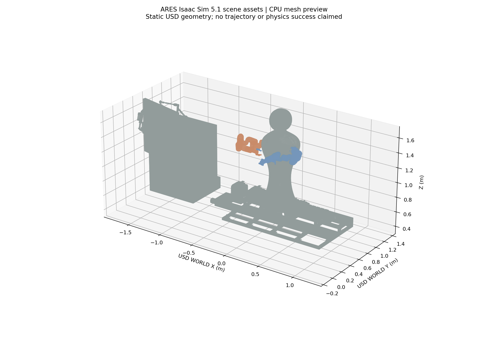

# ARES × ARES-R 研究汇总：190 服务器与 CASH v0

2026-10-13。主计算服务器已改为 `andyee@172.25.24.190:22`，主机名 `bjut1109`。现有 SSH 密钥登录成功，无需配置新密钥。研究分支仍为 `codex/ares-skill-handoff-p2-1-20261013`。

## 190 服务器实测条件

| 项目 | 只读审计结果 |
|---|---|
| GPU | 4×RTX 4090，24564 MiB/卡；检查时每卡2 MiB、利用率0%，未列出GPU计算进程 |
| 驱动 / CUDA | 560.35.05 / 已安装CUDA 12.6.85，nvcc在 `/usr/local/cuda-12.6/bin` |
| CPU | 双路 Xeon E5-2699 v3，36核72线程，2 NUMA节点 |
| 内存 / Swap | 总188 GiB，可用约183 GiB；Swap总15 GiB、使用389 MiB |
| OS / Docker | Ubuntu 22.04.5；Docker28.1.1；NVIDIA容器runtime存在 |
| 磁盘 | 根分区1.8T，已使用91%，可用159G；不能擅自清理现有镜像 |
| GPU互连 | GPU0/1、GPU2/3分别通过PHB，其余SYS；没有NVLink连接 |
| 当前系统Python | 3.10.12，仅查到NumPy1.21.5；未查到torch/cuRobo/Isaac/MuJoCo |
| 当前容器 | 只有natfrp-service处于运行状态；现有机器人镜像尚未检查内部环境 |

这些是检查时的资源快照，不能当作长期独占授权。暂定先在一张空闲卡上测一个持久Oracle Worker，其余卡待吞吐与任务占用确认后再扩展。每个进程最多使用所属单卡显存。

Isaac版本按用户要求固定5.1。190驱动比[NVIDIA 5.1官方测试版本580.65.06](https://docs.isaacsim.omniverse.nvidia.com/5.1.0/installation/requirements.html)旧；这表示兼容性尚未验证，不能仅据版本号断言一定无法运行。本轮没有升级驱动、重启、启动实验容器或开展GPU任务。

## 上次已推送的内容（3ec7bd9）

| 内容 | 已完成 | 实际验证 / 限制 |
|---|---|---|
| Gymnasium三阶段环境 | D0抓取分支、D1 center、D2 preplace接口；固定观测空间、mask、终止状态 | 接口checker通过；三阶段后端使用人工fixture做软件测试，真实数据树未采集 |
| 规划缓存 | request/result/validation来源SHA、episode lineage、scene-group分割 | 不接受未验证端点结果、人工研究标签或TIMEOUT作为负任务标签 |
| 学习入口 | 监督终态预测器、MaskablePPO CPU训练与独立评估脚本 | 16步MaskablePPO人工fixture集成通过；没有正式研究训练曲线 |
| CASH网络 | 已有masked actor-critic与successor-effect head | 新PPO训练入口仍是标准MaskablePPO基线，auxiliary head尚未集成 |
| Isaac5.1截图 | Replicator headless捕获脚本、单GPU、自身进程组退出、独立日志 | 仅语法检查；尚未在正常GPU上启动验证 |
| 场景预览 | 读取已有USD并绘制181个实例化可视网格 | CPU静态几何，非Isaac RTX截图或物理任务成功 |
| 验证 | 14个研究测试通过；训练脚本CLI可启动 | 未测真实Oracle warm-up、吞吐或算法改善 |

## 给导师看的现有图

来源：ARES已有 `isaac_sim/simforge/scenes/main.usd`。图中机器人与工位来自真实USD网格，使用简化配色；没有模拟轨迹或物理执行成功含义。相关哈希在同目录 `manifest.json`。研究目标所需的持物center与规划轨迹叠加图尚未生成。

## 已证实的问题

- 原6场景×4候选的CPU负结果保留。P2.1扩展到10场景、120个固定候选格、52个合法center终态后，合法候选内仍没有端点可行性差异。
- 端点可达与successor-start混用不足以评价候选终态；后续需比较从每个终态出发的整段真实规划路径。
- 旧Groove开口与持物代理尺寸冲突；Cabinet端点偏容易。直线关节插值失败不能当cuRobo不可行。
- USD保存姿态与历史BODY基座合同尚未对齐；两臂反推完整变换不一致。腕部Gemini2引用也有 `https:/...` 路径问题。
- 本地3080仍有NVML驱动不匹配；190正常枚举GPU，但Isaac5.1兼容性尚未验证。

## 接下来执行顺序

1. 在190个人研究目录保留上次commit源码快照、模型和哈希，使用独立环境；优先检查已有容器内可复用的cuRobo/PyTorch，避免重新下载大镜像。
2. 测一张卡的CUDA与cuRobo warm-up，构建真实附着几何与场景重绑定的请求；用一个Groove、一个Cabinet拿到候选轨迹和独立验证。
3. 单独验证Isaac5.1兼容性及headless截图，完成WORLD/BODY安装变换校验。
4. 真实路径缓存先训练Ranker，再训练MaskablePPO与CASH原型，与ARES-R全链启发式、等预算搜索比较。

当前还不能声称“已恢复Isaac物理仿真”“四卡吞吐提升”或“CASH优于基线”。最有价值的下一条证据是同一场景的成对真实轨迹，而非新增网络层数。

