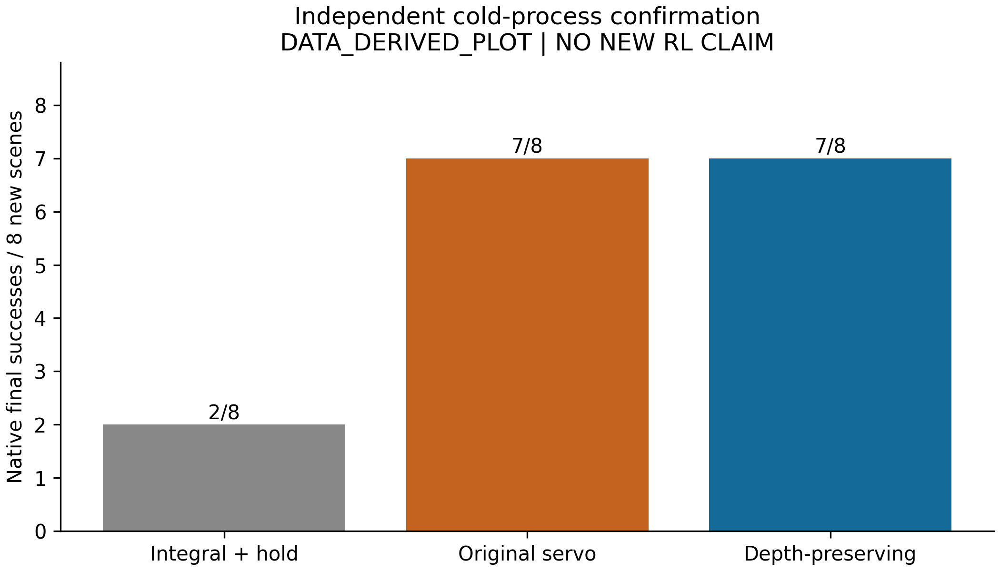

# EXP-001：冻结控制器独立确认与撤回机理

代码冻结：932c0f9（反馈控制源码与1325b18一致）；分支research-sci-program。
本轮28个完整episode、8个新初态、5600真实控制步、0训练更新；历史数据不合并计分。
公开PlugCharger-v1，原生200步/20 Hz、位置≤5 mm且姿态≤0.2 rad终态成功；GPU0，网络隔离，无实机。

## 独立确认

预先固定726000–726007，每个scene×controller单独冷进程；相同15°抓持/25 mm接近。

|控制器|终态成功|相对原积分救回/退化|总episode墙钟|规划/IK累计时间|
|---|---:|---:|---:|---:|
|原积分+goal hold|2/8|—|46.49 s|0.386 s|
|原版servo+goal hold|7/8|5/0|46.69 s|0.246 s|
|当前深度保持servo|7/8|5/0|47.01 s|0.208 s|

原积分与深度保持配对精确双侧p=0.0625；不能称小样本已显著。
深度保持相对原版servo救回0、退化0：**独立组未证明成功率额外提高**。
7个共同成功案例首次满足原生目标的平均步数139.29→120.57，减少18.71步（0.936 s仿真时间）；两者都执行到200步确认终态，因此不是episode计算时间缩短。
7/7到达ALIGN的记录状态完全一致；726005在三组都于抓持失败，不能记为一个后段配对。
原积分其余5例记录到接触但终态失败；两个servo在已到达后段的7例全部成功。
这是几何控制收益，**NO NEW RL CLAIM**；没有实机、泛化或非特权感知结论。



## 机理：先前失败并非全部来自接触动力学

|已看诊断case|旧/新模式切换|旧/新累计反向轴向移动|旧/新终态成功|
|---|---:|---:|---:|
|725002|26 / 3|41.366 / 0.00045 mm|0 / 1|
|725005|40 / 7|39.106 / 0.258 mm|0 / 1|

累计反向移动是servo期间负位移之和，不是净损失；旧版两例接触代理峰值均0，修正版分别3.773 N、1.127 N。
支持“对齐门限触发撤回，阻碍接触建立”的解释，未证明极限环、稳定性或力/位混合控制理论。
两例属于事后诊断，不与新8例合并。所有曲线由原始状态计算；servo字段是前一观察选出的动作模式，状态是执行后测量。

- [725002 原图](725002/RAW.png) · [英文标注](725002/ANNOTATED.png) · [同步曲线](725002/TRACE.png) · [图注](725002/CAPTION.md)
- [725005 原图](725005/RAW.png) · [英文标注](725005/ANNOTATED.png) · [同步曲线](725005/TRACE.png) · [图注](725005/CAPTION.md)

RAW/ANNOTATED为MEASURED_POSE_REPLAY，新增物理步0；TRACE为DATA_DERIVED_PLOT，300dpi及SVG。
圈注使用真实相机矩阵投影实测actor原点，并非猜测接触点或遮挡处可见性。
首次图像审查发现原生相机挂载在插座上，导致725005投影出画；已显式解除挂载并重渲染，物理数据未改变。

## 共享抓持失败：4次事后物理诊断

保持新servo，分别对失败726005和成功726000测试既有合法角−15°、45°，接近仍25 mm。

|初态|−15°|45°|参考15°|
|---|---|---|---|
|726005|抓持失败|抓持通过但后段SERVO_IK_FAILED；终态失败|抓持失败|
|726000|后段终态失败14.77 mm|抓持失败|成功3.61 mm|

4次均未终态成功，证明参数会改变物理路径/失败阶段，却没有形成优于强默认的决策收益。
不能把“抓持通过”算成完整任务救回，也不能把不同抓持参数后的ALIGN当相同后验状态。
完整记录见GRASP_DIAGNOSTIC.json，包括失败、源trace和运行manifest。

## 科学决定与下一实验

EXP-001的独立控制器确认已完成；当前接触分布下强规则解决了所有进入后段的新案例。
**不据此推进EXP-002接触参数训练**，也不为了得到RL增益去削弱控制器。
保留EXP-001为活动实验：下一步检查前段抓持的实际几何/闭合/抬起与后续IK合同，
用少量新设计初态检验可执行抓持深度/姿态是否存在完整任务收益；优先规则可行性筛选作强基线。
若剩余只是可修复的技能控制缺陷，继续修基线或明确转向真实任务条件变化，不再堆同分布servo确认。
当前完整物体位姿和速度已包含位置差、对齐、相对运动等多数“后验反馈”；历史并不自动新增信息。
只有验证潜在摩擦/滑移或有限观测的可辨识影响后，才能提出独立效果历史机制。

## 复现与追溯

源脚本在 `research/skill_handoff_lab/tools/`：
`program_charger_cold_confirm.py`（新目录运行24个冷进程）、`program_charger_mechanism.py`、`program_charger_visual_evidence.py`。
物理runner和反馈控制器本轮没有修改。抓持诊断实际启动脚本另存本目录 `run_grasp_diagnostic.py`。

```bash
python3 research/skill_handoff_lab/tools/program_charger_cold_confirm.py --out /absolute/new-run-directory --python /home/andyee/robot-research/ARES-Skilllab/envs/method-evolution-20261028/bin/python
python3 research/skill_handoff_lab/tools/program_charger_mechanism.py --root /absolute/run-directory --out /absolute/evidence-directory
bash research/skill_handoff_lab/tools/handoff_offline.sh /home/andyee/robot-research/ARES-Skilllab/envs/method-evolution-20261028/bin/python research/skill_handoff_lab/tools/program_charger_visual_evidence.py --root /home/andyee/robot-research/ARES-Skilllab/runs/research_program/EXP-001 --out /absolute/evidence-directory
```

机制图还需要历史725002/725005轨迹；仅新24例目录不能单独重建历史图，需按CONFIRMATION/visual_manifest索引提供这些目录。
原始非Git数据：`/home/andyee/robot-research/ARES-Skilllab/runs/research_program/EXP-001/`。
CONFIRMATION.json含逐例指标、源SHA、执行源码/依赖SHA；每组visual_manifest含帧号、矩阵、像素投影、文件SHA。
QA.json记录验收。整个研究累计102完整episode、20505物理步（含历史崩溃105步），22个场景；不是102独立场景。
