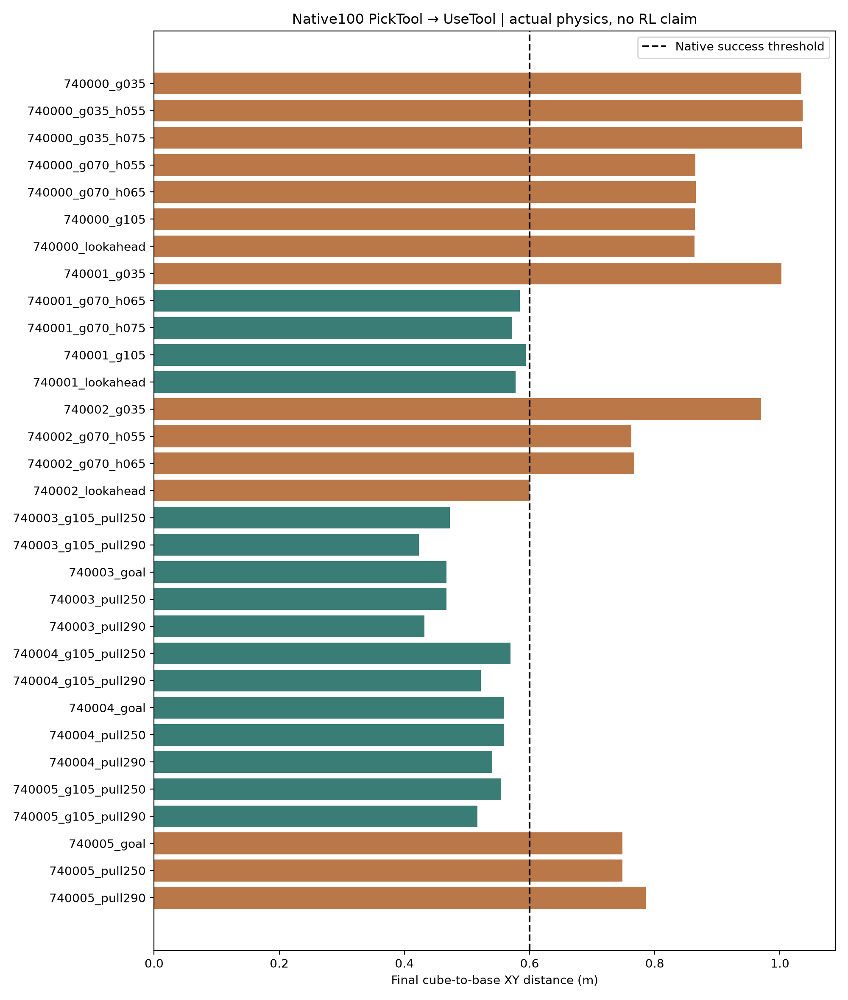
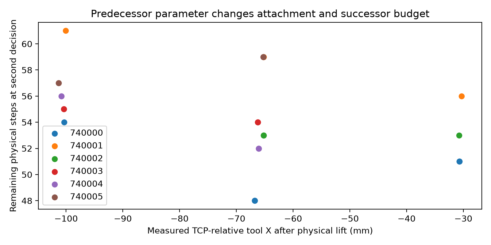

# EXP-003B: two physical skill decisions on native PullCubeTool

**Final panel:**31 native100 parameter episodes,3100 control steps. The later100Hz instrumentation pair adds200 steps separately. Four additional failed-strong-state hook tests all fail; details below.

Executed 12 cold-process episodes on three new native scene seeds
740000–740002: **1,200 physics steps, zero optimizer updates**. Every episode
uses the unmodified native 100-step horizon and cube/base XY distance <0.6 m
terminal success criterion. No inter-skill reset, state restoration or object
teleport is used. All 12 episodes contain both real decision boundaries.

The strong baseline is copied from the existing measured-attachment controller:
pre-grasp lookahead over 70/105 mm handle points, followed by actual grasp,
55 mm commanded lift and a nine-candidate post-grasp geometric hook search.
It is not the weaker original official demonstration planner. Explicit grasp
and hook choices are physical parameter interventions; other permitted
dimensions retain the same geometric optimization. In particular a fixed
hook-Y intervention still selects yaw by the same post-grasp search.

## Measured chain

1. `PICK_TOOL` parameter decision uses initial geometry. The robot physically
   approaches, closes the gripper and lifts. `SkillResult` records retained
   grasp, actual tool/TCP transform, velocities, measured lift and remaining
   native steps. Measured lifts range 44–58 mm; this is not a claim that the
   tool is fully settled at the boundary.
2. `USE_TOOL` selects hook Y/yaw from this actual state and measured attachment,
   then physically transfers, hooks and pulls. Its result is the native
   terminal outcome at step 100, including all failures and holds.

## Initial evidence

| Scene | Strong lookahead | 35 mm grasp + same strong suffix | 105 mm grasp + same strong suffix |
|---|---|---|---|
| 740000 | fail, 0.8633 m | fail, 1.0345 m | fail, 0.8640 m |
| 740001 | success, 0.5776 m | fail, 1.0023 m | success, 0.5937 m |
| 740002 | fail, 0.600060 m | fail, 0.9697 m | not run |

Strong baseline is **1/3**, not pooled with the intervention successes. The
last baseline case misses the strict native threshold by approximately
0.060 mm; it remains a failure. A hypothesis that one more step would solve
it is not measured success and does not change the native budget.

On scene 740001, additional 70 mm grasp / hook −65 or −75 mm interventions
both succeed. On scene 740000, 35 mm grasp / hook −55 or −75 mm both fail.
All six same-grasp suffix comparisons have exactly matching recorded physical
boundary states. Initial state hashes match across all interventions per seed.

The predecessor parameter changes actual attachment (roughly −31/−65/−100 mm
TCP-relative tool X), remaining execution budget, and the later physical cube
motion. Scene 740001 with a 35 mm grasp has **9/9 predicted kinematic/budget
feasible suffix candidates**, but the cube moves away during transfer/hook
(base distance 0.8335 → 1.0023 m) and the subsequent pull fails. The strong
70 mm grasp completes the task. Thus the observed difference is not only an
IK-validity label. The exact cause of the unwanted cube motion is not yet
isolated: current logs measure tool/cube force but not every robot/cube contact.
Do not infer a particular collision partner solely from the displacement.

Conversely, a predicted insufficient budget does not prove failure:
740001/105 mm succeeds despite a shortest predicted suffix of 62 steps and
61 remaining. Native goal satisfaction can precede completion of a nominal
path. Planned durations/candidate validity are predictors, not physical labels.

## Scientific decision

The two-stage interface and predecessor-to-successor physical dependence are
established on these examples. **No policy or RL gain is established.** The
limited hook interventions do not rescue a strong-baseline failure, and no
reliable task-dependent reversal of the best parameter has yet been shown.
Do not train a network merely on the same failing 35 mm grasp examples.

The next informative bounded intervention is legal pull displacement/target
selection coupled to the remaining budget, alongside shared geometric
lookahead and measured attachment. Preserve the original 270 mm pull as a
baseline, test nearby legal targets on the borderline/new scenes, and measure
complete outcomes. Longer requested pulls may slow execution; a theoretical
target extension is not assumed to help. If geometry/budget-aware control
resolves the cases, record the control improvement separately and seek a
genuine cross-condition parameter ranking before proposing new RL.

## Provenance and reproduction

`program_multiskill_pull.py` is the physical runner;
`program_multiskill_analyze.py` generates this directory's machine-readable
tables and two independent figures. Each run stores native task source SHA,
pinned ManiSkill revision/license SHA, exact local runner/dependency snapshots,
full initial state, every physical step, both decisions, SkillResults and
all planned candidates. Public ManiSkill/SAPIEN simulation only; no field data.

Raw root: `/home/andyee/robot-research/ARES-Skilllab/runs/research_program/EXP-003/multiskill_pull`.
Invoke the physical runner through `tools/handoff_offline.sh`; each invocation
uses a new output directory and one scene/configuration in a cold process.
The initial bounded queue scripts are retained beside that raw root.

`QA.json` verifies SHA, horizon, terminal flags and both boundaries.
`SUFFIX_PREFIX_PAIRS.json` gives numerical state equality for suffix contrasts.
The selected full-cycle video pair is 740001/35 mm versus 740001/strong
lookahead: parameter intervention versus strong control, **not** a new-method
rescue. Rendering the saved poses introduces no new physical evidence.

## Expanded native design panel: 27 episodes / 2700 physical steps

Three further native initial seeds740003–740005 compare fixed250/290mm pull and an observed-geometric rule targeting0.58m cube/base distance, bounded to250–290mm. All preserve the same nine-candidate yaw/hook search and measured attachment feedback. Each scores2/3; the rule clips to250mm on all three and is exactly equal to fixed250 in recorded outcomes. With grasp105mm, both fixed distances score3/3. Seed740005 is rescued by changing grasp at either distance; no change in second-parameter success ordering is established. This is a genuine predecessor-parameter effect, not evidence that a new learned cross-stage mechanism is required. A fixed105mm grasp is a stronger candidate baseline on this tiny design panel, and must be compared before claiming learned gain.

All27 episodes have two actual physics-separated decisions and100 native steps; same-seed initial hashes match. Full raw source snapshots distinguish the original27cm suffix from the later explicit distance parameter. `PAIRED_POLICY_OUTCOMES.json` reports same-case outcomes. Success is native terminal success; `Horizon` diagnostics are retained even for a run whose terminal state succeeds.

Reset-frame tool/cube force is **unvalidated** because a nonzero contact buffer appeared before the first actual step despite separated geometry. It is retained raw but is not used by these policies or interpreted as physical contact. Valid force plots start after the first env.step. The failed35mm grasp can move the cube away with little tool/cube force; robot/cube pair forces were not logged, so the precise colliding partner is unresolved. Videos must not call that proven tool contact.

## Failure attribution and raw package

Of27 episodes,16 achieve native terminal success. All27 retained the tool after lift. Five failures have a selected predicted suffix cost exceeding remaining budget; six fail despite selected predicted kinematic+budget feasibility. The predictor has six false positives and one false negative relative to native final success. These are diagnostic strata, not proof that predicted budget alone caused a physical failure. In particular, a valid/budget-feasible35mm grasp chain can push the cube away during transfer/hook and then fail to engage it.

`RAW_EVIDENCE.tar.gz` contains all27 complete100-step traces, initial full states, native joint command sequences, planning paths, boundary/parameter records and exact source snapshots/manifests. Every file's SHA256 is in `RAW_EVIDENCE_MANIFEST.json`. No real hardware or restricted field data are included. `program_multiskill_package.py` reproduces the archive/manifest from local saved results after verifying trajectory hashes.

## Contract falsifier (descriptive, no fitted model)

The selected suffix's signed remaining-step margin gives in-panel AUC0.6335 over27 executed episodes; its zero-threshold feasibility confusion matrix is TP15/FP6/FN1/TN5. Goal-distance repeats the exact fixed250 applied parameters on three scene states. Counting each unique seed+actual grasp/yaw/hook/distance once gives24 configurations,14 successes,TP13/FP5/FN1/TN5 and descriptive AUC0.6929. All27 executions still count toward real physical cost. These are six scene draws, not27 independent tasks; no calibration or held-out generalization is inferred.

This falsifies using the current kinematic+budget number as a sufficient physical-value label. It does not show that a learned value must outperform a stronger physical geometry/contact baseline. The actual attachment is derived from current TCP/tool poses already in full state, and velocities are also observed; no extra hidden posterior information or POMDP advantage is claimed. No tiny-panel supervised ranker was fitted.

Scope clarification: the implemented diagnostic tests only the naive kinematic/budget-margin-as-value proxy. A distributional execution model, cross-contract relabeling, or any proposed RL mechanism remains **PROPOSED_NOT_IMPLEMENTED / NOT_TESTED** here. These results neither validate nor falsify that untrained candidate.

## Failed-strong-prefix hook coverage follow-up

The original hook grid did not cover strong70mm-grasp failures adequately. Four additional same-initial-state tests fix70mm grasp and hook−55/−65mm with the same yaw search, on seeds740000/740002. All fail: final cube/base distances are0.86502/0.86543m and0.76292/0.76745m respectively. Original selected−75mm gives0.86328m and0.600060m. Thus neither these alternative hooks nor the earlier length sweep establishes second-action success improvement. This is still a bounded design panel, not a theorem about all legal parameters.

Final31-run proxy confusion isTP15/FP6/FN1/TN9 (16successes); descriptive in-panel margin AUC0.7292. Deduplicated28 applied-condition cases giveTP13/FP5/FN1/TN9,14successes,AUC0.7781. Earlier27-case numbers above are retained as the interim analysis, not mixed with the final panel. Proposed distribution/relabeling methods remain unimplemented/untested.
