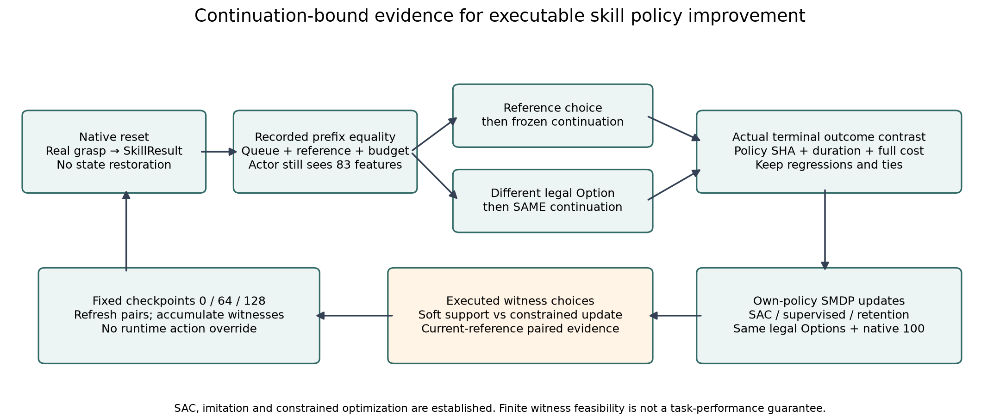
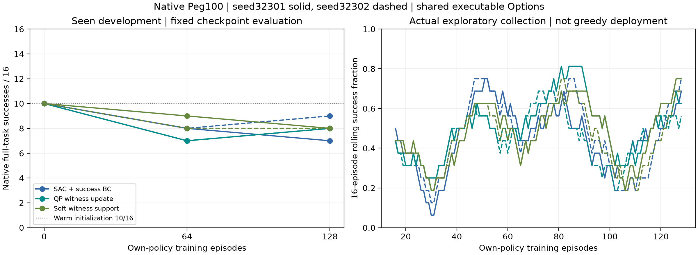
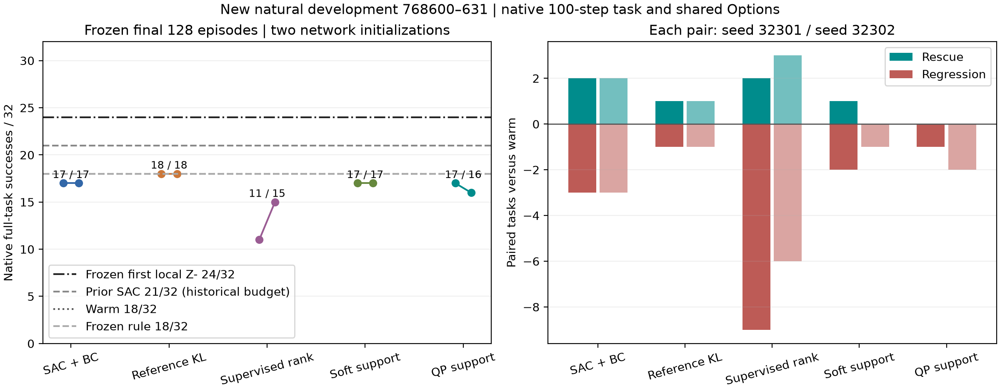
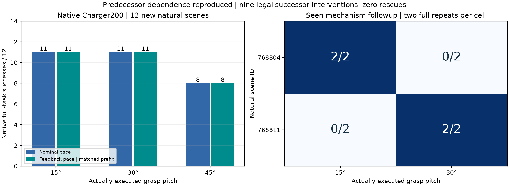

# Executable skill adaptation above strong manipulation controllers

Working manuscript, 2026-11-05. The current study combines explicit skill execution semantics with baseline-relative learning of complete Option interventions. Historical representation experiments remain below. Independent algorithm superiority is not assumed. Native simulation evidence only; no hardware or sealed-test claims.

## Problem

A small skill parameter is not necessarily a small change in robot execution. In a planner-backed manipulation skill, a command can both reconstruct a target from the currently measured object–gripper transform and add a local offset. The resulting trajectory change mixes reference correction with residual adaptation. We study whether exposing these operations separately improves reinforcement learning across an actual grasp-to-insertion handoff while preserving strong nominal execution.

The task is to select a grasp parameter and subsequently adapt a contact-rich skill from physical feedback under the original task horizon. The objective is terminal native success; paired rescues and regressions and physical/planning costs diagnose reliability. We do not redefine success or treat planned kinematic feasibility as insertion success.

## Related work

Residual learning is an established foundation. rLfD (Davchev et al., RA-L 2022, https://arxiv.org/abs/2008.07682) corrects a demonstrated DMP using task-space/full-pose residual policies with an impedance controller. Its DMP runs at 100 Hz and learned correction at 10 Hz; our endpoint modification followed by a full motion replan is not that low-level residual interface. Johannink et al. (https://arxiv.org/abs/1812.03201) establish combining conventional control with learned residuals. Neither additive correction nor combining a strong controller and RL is claimed novel here.

Fabrica (https://fabrica.csail.mit.edu/, official code https://github.com/yunshengtian/Fabrica) integrates assembly planning and learned execution. It is a close planning/learning reference, not evidence that our actual grasp attachment can be treated as fixed. Policy Decorator (https://arxiv.org/abs/2412.13630) motivates base-policy protection and controlled exploration; our successful-trajectory BC and bounded exploration are mature comparators, not inventions. Option/SMDP execution and reference continuation are likewise foundations inherited from prior experiments.

The candidate distinction is operational: separately retaining an active plan, explicitly refreshing its measured reference, and modifying its existing endpoint. Its value must be established against standard residual/replanning representations under matched training, not asserted from terminology. Equal action counts do not imply equal execution authority: measured offsets can refresh and shift atomically, whereas the separated offsets cannot. Temporal access to decisions must also be matched or treated explicitly as the experimental factor.

## Method

Let x be physical state, Q the current joint-plan queue and cursor, T its requested endpoint, and b the remaining native budget. An executable action is a map on this execution state, not an additive motor command. The actor receives the same 64-dimensional observation in all arms: measured robot/object/goal quantities, stage/budget, and queue summaries. Full Q and T are logged but are not privileged actor inputs; partial execution-state observability is a limitation.

The first boundary selects one of three physical grasp offsets. At subsequent open Option boundaries, eight labels expose different one-boundary physical maps: continue; refresh the target from actual attachment; goal-frame Y or Z offsets of ±3 mm; withdraw 6 mm; or hold. In the separated interface, offset actions use p'=p_T+R_goal δ and R'=R_T. In the measured interface, they use p'=p_F(x)+R_goal δ and R'=R_F(x), where F reconstructs the target from actual attachment. Thus the requested position change includes p_F(x)−p_T in the latter. This decomposition is not a measured numerical amplification factor.

Action 0 continues the current queue, including earlier accepted corrections. It never restores an original nominal trajectory. Accepted endpoint updates invoke the same full MPLib planner and shared retiming. They do not guarantee a 3 mm realized displacement or smooth local motor perturbation. Failed replans retain the existing queue. Hold and initial-plan-failure cases anchor the relative interface to the actual held TCP. These are execution semantics, not novel RL updates.

Both interfaces use the inherited discrete SMDP SAC learner and reference-continuation Option. Physical durations and remaining budgets are recorded in Option transitions. The current finite-horizon learner uses undiscounted return (gamma=1), so it does not apply an additional duration discount. The frozen reference governs continuation until the inherited termination condition. In this implementation that condition uses grasp loss or queue exhaustion together with a capped planner-call-count feature (slot 49), not a separately observed semantic phase label. It is shared by all arms and remains an implementation limitation; we do not claim a verified semantic contact-event termination mechanism. The reference weights are identical across arms, though the interface changes their physical action meaning too. Successful-trajectory BC is the second learning factor. Every online arm collects its own trajectories; transitions are never relabeled across interfaces. Three grasp parameters remain learned throughout.

## Preliminary experiments

### Matched online factorial and continuation

We retain the historical measured-interface endpoints and collect the two missing active-target cells using the same inherited neural checkpoint, 64 training initial states, replay/exploration seed 31601 and 5,120 Actor/Critic iterations per arm. Every arm collects its own physical experience. The 16 development initial states are previously seen; they are not independent testing. Three real grasp choices remain learned throughout.

| Interface / learner | Development success at 0/32/64 episodes | Final64 rescues / regressions versus nominal |
|---|---|---|
| Measured / SAC | 9 / 10 / 6 | 1 / 4 |
| Measured / SAC + successful BC | 9 / 8 / 9 | 1 / 1 |
| Active target / SAC | 9 / 7 / 6 | 0 / 3 |
| Active target / SAC + successful BC | 9 / 8 / 8 | 0 / 1 |

The shared nominal controller scores 9/16. The frozen measured and active-target rules score 8/16 and 9/16. The factorial does **not** establish a development-set advantage for the separated interface. Its final SAC/BC policies make 30/19 feedback replans versus 20/11 for the measured policies; all these replans return success. Kinematic planning status is therefore insufficient to explain terminal task outcome.

We then extend the stronger BC learner in both interfaces by the same additional 64 new training episodes, preserving each arm's model, optimizer, replay and RNG. At cumulative64/96/128 episodes, measured BC scores 9/8/8 and active-target BC 8/7/7. An independent replay/exploration repeat (31602) from the common inherited weights scores 8/7 and 7/6 at64/128. These are independent stochastic learning runs, not independent neural initializations. The predeclared highest-development-score/earliest-tie rule selects64 for all four policies. Failed later checkpoints and their full costs remain included. Historical final64 is never replaced by a selected score.

### Frozen confirmation on new natural conditions

All four models were frozen before evaluating initial states760200–760215. After both active-target runs showed fewer regressions, we declared a second cohort760216–760231 without changing any policy or rule. This adaptive extension is disclosed; the results are preliminary descriptive evidence, not a sealed fixed-sample significance test.

| Frozen method | Cohort1 /16 | Cohort2 /16 | Total /32 | Rescue / regression vs nominal | Planning queries |
|---|---:|---:|---:|---:|---:|
| Measured BC,31601 | 5 | 9 | 14 | 0 / 5 | 250 |
| Active-target BC,31601 | 7 | 10 | 17 | 0 / 2 | 269 |
| Measured BC,31602 | 4 | 8 | 12 | 0 / 7 | 262 |
| Active-target BC,31602 | 7 | 11 | 18 | 0 / 1 | 260 |
| Measured frozen rule | 6 | 11 | 17 | 1 / 3 | 262 |
| Active-target frozen rule | 5 | 11 | 16 | 0 / 3 | 256 |
| Nominal continuation | 7 | 12 | 19 | 0 / 0 | 221 |

The supported positive trend is **reduced policy-induced regression under the separated execution representation**, relative to the same mature learner. It is not new nominal-failure recovery, and nominal continuation remains strongest. Planning cost is not uniformly reduced: the first active-target run uses19 more queries than its measured comparator. The32 initial states are shared across methods and training repeats and must not be treated as64 independent scenes.

### Physical mechanism and competing explanations

Historical same-prefix probes distinguish a requested offset from reference reconstruction. A measured3mm correction can change the requested endpoint by up to21.98mm because the reference also changes; this is not a verified sevenfold numerical amplification. Across16 signed-Z comparisons in eight reachable grasp/scene contexts, median maximum first-four-step joint-command deviation from continuing is0.01233rad for measured-reference correction and0.00344rad for active-target correction. These are joint-vector command norms, not TCP displacement or tracking error. Shared contexts are not independent samples. Reduced immediate disturbance does not imply the online development gains absent above.

Twelve new full-task shared-grasp diagnostics separate predecessor and successor behavior. In759205, the active-target policy succeeds only with grasp0, whereas the measured policy succeeds with all three grasps. In759202, only the measured policy with grasp0 succeeds. These selected development cases are mechanism evidence, not new generalization scores.

Case759205/grasp1 provides a temporal counterexample. After94 identical recorded physical steps, the active-target policy requests3mm, replacing a queue at cursor8/16 with a new15-point queue at cursor0 while only6 native steps remain. Continuing succeeds; replanning fails. A further controlled experiment replans to the **identical endpoint**, producing14 points and still failing. Replanning is sufficient to cause failure without endpoint movement. It does not uniquely separate changes in joint-path geometry, initial-velocity treatment and retiming. Four additional natural mechanism cases show unchanged terminal outcomes among continue, zero-offset replan and3mm replan. These15 episodes support a counterexample, not a population frequency estimate.

“Identical prefix” means equality of the recorded initial state and per-step joint positions/velocities, TCP/peg poses and motor commands under full native reexecution. No approximate PhysX state restore is used; every hidden solver variable is not inspected. At the failing94-step state, the frozen Actor assigns approximately0.66 probability to action2 even though the Critic's mean estimate of continue is slightly larger than action2. The Critic prefers another untested action most, so this is not evidence that greedy-Q deployment would solve the case. Q values include shaping and entropy and are not calibrated success probabilities.

Two competing explanations remain open. Matching inherited weights also transfers a Critic trained under different physical action semantics; equal initialization does not imply equal adaptation difficulty. The actor also lacks complete endpoint/queue context. Neither explanation is causally established here. The frozen reference issued only continue in the active-target BC final64 evaluation, excluding repeated reference intervention as the explanation for its extra replans.

### Actual costs and reproducibility

This cycle adds512 training episodes,51,200 training physical steps and3,467 effective RL decisions. Actor and Critic each receive40,960 updates. Legacy auxiliary networks receive the same number of iterations but are not consumed by the ordinary policy or Bellman target; their cost is retained. Optimization totals208.10 seconds.

Training, evaluation and mechanism experiments total1,067 complete native episodes,106,700 physical steps and8,764 planning queries. Summed planner time is41.86 seconds and summed episode time6,303.06 seconds; these are sums across concurrent runs, not elapsed wall time. Historical measured-cell costs are separate. All raw traces, source snapshots, named checkpoints, final transactional resume states, failures and SHA records are retained. Video rendering replays measured states and adds no physical steps.

## Historical 9a66e94 method direction and limits (superseded below)

The next candidate is **reference- and progress-explicit skill adaptation**. A reasonable standard local-residual comparator modifies the unexecuted nominal waypoints smoothly while preserving their schedule, subject to IK, collision and shared dynamic checks. Explicit reference refresh remains separate. An infeasible correction must retain the current queue; a15-point plan cannot be compressed into6 steps or granted additional native budget. This comparator is prepared conceptually, not claimed implemented or trained here. Standard residuals and execution fixes are not renamed as algorithmic originality.

The existing native PlugCharger200 implementation provides a concrete second-task reuse path: real grasp pitch15–45 degrees followed by contact advance/angular pacing, with measured attachment and native success. `program_native_charger_sac.py` supplies ordinary two-boundary SAC and `program_charger_feedback.py` the strong local IK servo. Its54-dimensional continuous interface is incompatible with Peg's64-dimensional discrete replay/weights. Transfer should examine actual servo reference/progress semantics, not manufacture a queued-replanner failure. Historical strong depth-preserving control is retained; no new second-task result is asserted.

The current evidence supports an execution-semantics problem, a trained representation variant, a preliminary retention benefit on frozen new conditions, and a physically tested zero-offset-replanning counterexample. It does not establish superiority over strong nominal control, new recovery capability, an independent SAC innovation, robust cross-task transfer or publication-level generalization. The negative seen-development results, shared neural initialization, adaptive confirmation extension and partial execution-state observation remain explicit. Problem, Method and Experiments can now be developed from these concrete claims while the next implementation addresses the demonstrated execution deficiency.


## Current revision: atomic execution and temporal authority (2026-11-05)

The new evidence changes the interpretation of the earlier interface comparison. On the previously viewed32 conditions, fixing the real predecessor to grasp1 yields15/32 for the measured successor and17/32 for the relative successor (seed31601). Swapping predecessor policies gives13/32 and17/32 respectively, versus original joint14/32 and17/32. This posthoc decomposition retains a successor difference but shows that predecessor effects and individual scene identities matter; the joint difference is not an isolated rear-controller causal estimate.

At760213, all branches reexecute the actual prefix from the native initial state. At step76, one refresh, one local offset, one atomic refresh+offset, and sequential refresh/offset all fail. Repeated atomic updates at subsequent refinement boundaries succeed; insertion-queue commitment prevents the necessary updates, while phase reopening preserves them. An initial epsilon-based probe triggered at72 instead and is retained separately; the exact76-step experiment confirms the result. A parameterized closed-loop Option reproduces the original frozen-rule success across all100 recorded physical steps. This establishes an executable standard skill capability, not a learned generalization result.

The new common interface has12 actions: continuation, refresh, four active-target offsets, withdrawal, hold, and four atomic refreshed offsets. All learned arms receive83 observed features, including executor phase and current reference differences; they still do not receive the full future queue or future outcome. Fresh neural weights are initialized by512 standard supervised nominal-policy updates on16 actual native training episodes. Online arms retain separate empty replay initially and learn all three grasp choices. Shared discrete SAC and successful-episode BC are unchanged.

The controlled learning factor is temporal execution: queue commitment, semantic phase reopening, or a parameterized atomic Option that refreshes the selected offset at refinement boundaries and then continues insertion. The last changes the temporal policy class; it is not an equal-primitive-frequency algorithm-only comparison. A policy's zero action continues the current queue. No branch extends the100-step horizon or uses waypoint count as a success feasibility oracle. Final64 remains the original endpoint; future frozen confirmation uses a separately declared identical development-selection rule. All declared jobs completed; the final tables and limitations are reported below.

### Executable action authority and temporal policy class (2026-11-05)

We model a feedback decision by its reference transformation, physical planner call,
and permitted continuation, rather than by its integer action label alone. Let
\(T_a\) denote the active target and \(T_r(x)\) the target reconstructed from the
measured grasp. Local adaptation applies \(T_a\Delta(\delta)\); atomic adaptation
applies \(T_r(x)\Delta(\delta)\) at one execution boundary. A refresh followed later
by a local action is not generally equivalent: intervening physics, queue ownership,
and remaining time can differ. Action zero continues the active queue; it does not
restore an earlier nominal plan. These are execution semantics, not a novel SAC loss.

The current common interface exposes twelve physical actions and 83 observed
features, including actual executor phase and active/measured-reference differences.
The predecessor retains three real grasp choices. Standard discrete SAC with
success-behavior regularization learns from its own native episodes. At genuine
policy-over-Option boundaries we aggregate realized rewards and physical durations;
for the inherited finite-horizon objective, gamma is one. Hence the standard target
is the aggregate return plus the nonterminal soft successor value, rather than a
new budget-probability surrogate. Auxiliary legacy heads remain unused in deployment
and their optimization cost is reported.

Three temporal policy classes share the executor and action alphabet. The queue
class delegates continuation to a frozen reference until the inherited termination;
the phase class also reopens at semantic phase changes. The parameterized atomic
Option holds a chosen reference-relative offset, refreshes that same offset at
subsequent refinement boundaries, and continues the insertion queue. Grasp loss and
insertion-queue exhaustion release control. It uses neither future success nor extra
physical time. This is a standard parameterized closed-loop Option, with precedents
in temporal abstraction; identical action alphabets do not make these temporal
policy classes identical. We compare their learning behavior as representations,
not as evidence of an independently novel SAC algorithm.

### Causal evidence and falsified simplifications

On seen diagnostic condition 760213, complete native reexecutions share the first
76 recorded physical steps. Neither a single refreshed offset nor a sequential
refresh/local operation rescues the task. Repeated refreshed correction with phase
reopening succeeds; the queue-committed single intervention fails. The parameterized
atomic Option reproduces all 100 recorded physical steps of the original successful
rule. Independent contact instrumentation measures first nonzero peg/fixture force
at step87 versus98 for the successful phase and failed queue continuations. Contact
force is diagnostic evidence, not an additional policy observation.

The learned policy on condition761202 selects a local correction at step63, whereas
a failing queue learner intervenes at step59. Four full native reexecutions establish
a shared63-step prefix: learned execution succeeds, suppression of that intervention
fails, nominal continuation fails, and that intervention alone followed by continuation
succeeds. This supports an actually learned useful action, not merely prediction
improvement. Its deployment uses a local action, so it does not isolate atomic
refresh as the cause of the training benefit.

A conservative fixed-time-grid IK splice rejected all ten probe corrections (eight
acceleration checks, one lost grasp, one insufficient queue). Rejecting and keeping
the old queue preserves the known late success but establishes no new correction
capability. The acceleration check is a setpoint finite-difference feasibility test,
not measured motor acceleration: tracking lag already makes some original next
commands exceed that test. We therefore do not infer that all requested residuals
are physically impossible, or claim certified contact safety.

### Completed own-policy training and frozen confirmation

Each arm uses64 own-policy native episodes and1280 actor/critic iterations; the five
completed arms total320 training episodes. Two neural initializations are independent,
while shared nominal warmup uses16 real episodes. Primary final64 development results
are queue9/16 and7/16, macro8/16 and12/16, phase6/16 (single seed). Intermediate macro
checkpoints reach11/16 for both seeds. This shows useful learned behavior and seed/time
instability, not robust improvement.

Before new confirmation, all methods used the same declared maximum dev0/32/64 score
and earliest-tie selection. Both queue models select initialization; macro models select
32 and64. The full64-episode cost is charged to each. On24 new natural conditions,
queue scores12/24 for each seed, macro10/24 and12/24, nominal12/24, and the frozen
feedback rule15/24. Macro rescue/regression counts are1/3 and1/1; rule counts4/1.
One learned rescue (762214) is not covered by the frozen rule, but aggregate superiority
is absent. These conditions are development confirmation, not sealed test data.

The first macro model assigns positive mean-Q differences to harmful first interventions
on762201,762204 and762206. On762206, both independent models prefer their harmful
intervention to continuation in estimated Q (+0.201 and+0.174). A simple Q-filter is
therefore not a verified solution. Conversely, the second model's successful762213
intervention has a slightly negative estimated difference (-0.009), emphasizing that
actual action value and policy extraction must be studied together. These are
descriptive frozen-model diagnostics, not estimates of calibrated success probability.

The only non-grasp1 choice in frozen confirmation is grasp0 on762209 by the second
macro model. Joint, fixed-front/learned-rear, and learned-front/fixed-rear all succeed
on full native reexecution there; this does not establish a new synergistic handoff
benefit. Three grasp parameters are genuinely explored during training, but the
selected policies predominantly use the nominal predecessor.

Four new native PlugCharger conditions with two actual grasp pitches and nominal/feedback
servo complete16/16 tasks at the original200-step horizon. The prefix duration varies
with actual grasp, but this small cohort is saturated and supports reusable controller
capability only, not cross-task learning transfer.

All current experiments account for1002 complete native episodes,101800 physical
steps and8934 planning queries. This includes every repeated physical prefix, training,
evaluation and mechanism control; video rendering contributes zero physics. Named
models, final transactional resume, exact training sources and all raw trajectories
are archived. Per-arm tables and costs are generated in
`evidence/EXP-004/2026-11-05/atomic_handoff/RESULT_TABLES.md`.

The current paper can support an executable-reference/temporal-authority formulation,
its concrete learned implementation, causal rescue cases, and a reproducible account
of generalization failures. It cannot yet claim stable superiority over mature
control, independently novel SAC, cross-stage synergy, or learned second-task transfer.


## Rule-relative, continuation-bound skill adaptation (current cycle)

### Problem and executable policy class

A useful intervention is conditional on its subsequent execution. The present experiment fixes the strongest inherited geometric controller, the native Peg100 predicate, the learned three-grasp predecessor, and two previously trained successor proposals. At a real successor decision, a policy chooses either the frozen rule or one complete proposal Option. After the chosen Option terminates, control returns to the frozen rule for the remainder of the same native episode. Choosing zero continues the currently active queue; it does not restore the original plan. Atomic offsets maintain their selected parameter across refinement boundaries, whereas non-atomic proposals retain their inherited continuation contract. Actual release, physical duration and command origin are logged.

The actor sees 83 execution features plus one-hot identities of the rule and candidate actions (107 inputs). A shared 107–32–1 tanh network scores each of the two proposals; a fixed zero logit represents waiting. Proposals equal to the rule action are masked. The physical predecessor remains present and can select three grasps, but its weights are frozen in this cycle. Consequently these experiments do not establish newly learned cross-stage coordination.

### Measured evidence and policy update

For each training initial condition, we physically execute the frozen-rule baseline from the original reset. A separate branch executes the candidate policy from that same original reset. Before its first deviation, robot/object states and physical commands are compared by exact serialized-prefix hashes. No contact-state restoration is used. The terminal label is delta = G(candidate Option then rule) − G(rule), with the original binary success predicate. This is an initial-condition-matched experimental label, not privileged information supplied to the deployed actor.

Let H be the observed waiting/adoption decision sequence, and let p_theta(H) be its probability. The online candidate uses a clipped likelihood-ratio policy update with advantage delta for rescues, 2*delta for regressions, and zero otherwise. The ratio is the product over all decisions in H, evaluated stably as an exponentiated difference of summed log probabilities. Eight gradient steps follow each nonzero outcome; no extra success-value head is introduced. Gamma=1 is appropriate to the terminal, finite native-horizon objective. The regression weight changes the optimization criterion and is shared with the cost-sensitive supervision comparator.

The significance of the full sequence is explicit: waiting choices determine which later intervention state is reached. An entry-only update omits their score-function terms and is a mechanistic ablation. The temporal likelihood ratio, clipping and measured baseline are mature policy-gradient ingredients. Neither the algorithm nor its safety is established by naming this combination. SPIBB's support constraints and theorem do not apply to this neural gate.

A shared cost-sensitive supervised initialization is followed by either this real online policy update or ordinary supervision on that arm's own adopted Option outcomes. Both arms explore with the same bounded categorical mixture and use the same observations, frozen proposals and physical budget. Greedy deployment is evaluated separately from stochastic exploratory training. A rehearsal control retains the common paired data during supervised online updates to test whether any apparent RL benefit is merely avoidance of ordinary forgetting.

### Experimental design and limitations

The first common dataset contains 64 new natural training initial conditions and 128 complete native executions. Each initial condition contributes one randomly selected reachable disagreement, rather than being counted multiple times as independent evidence. It contains three rescues, seven regressions and 54 unchanged outcomes. All seven harmful examples have positive historical mean-Q differences, while only two of the three rescues do. This directly rejects using the old behavior Critic as a calibrated rule-relative Option-value oracle.

Each online arm uses 64 different natural initial conditions and its own sampled physical data. The 16 development conditions are disjoint from both training groups; once examined they are development data, not unseen tests. Fixed final64, common-initialization checks and fresh confirmation conditions are declared before confirmation execution. Shared paired physics and counterfactual baseline episodes are charged to every comparison arm, while unique executed costs are additionally reported. No sealed data are accessed.

A first 500-update shared initialization did not even adopt the three positive training examples. A training-only convergence check motivated 2000 shared updates for both arms, retaining the earlier run as a negative result. The resulting initial model already rescues two development failures. Any benefit present at this checkpoint is supervised initialization, not online RL. The final tables distinguish that foundation from subsequent policy improvement.

The one-deviation restriction intentionally resolves one source of continuation mismatch but restricts recovery capacity. The observation summarizes rather than exposes the full future queue. Effects can be rare, initial-condition-correlated and time-sensitive. Current success retention is empirical, not a safety guarantee; a second contact mechanism and stable multi-stage learning remain necessary for a broader paper claim.


### Completed rule-relative results

| Method | Dev /16 | Frozen confirmation /24 | Rescue / regression vs shared rule |
|---|---:|---:|---|
| Frozen rule, shared predecessor | 9 | 16 | 0 / 0 |
| Frozen rule, fixed grasp1 | 9 | 16 | 1 / 1 |
| Frozen complete macro 31701 | 7 | — | — |
| Frozen complete macro 31702 | 10 | — | — |
| Historical Q gate | 8 | — | — |
| Fixed first proposal1 | 11 | 16 | 4 / 4 |
| Shared supervised initialization | 11 / 11 | 19 / 18 | 3/0 ; 3/1 |
| Online supervision | 10 / 10 | 18 / 19 | 2/0 ; 3/0 |
| Supervision + shared-data rehearsal | 11 | 19 | 3 / 0 |
| Online sequence RL | 12 / 12 | 19 / 18 | 3/0 ; 3/1 |
| Entry-only RL ablation | 12 | 19 | 3 / 0 |

The24-scene frozen confirmation separates a useful learned interface from an unproven online algorithm increment. Both final RL models exactly match their respective supervised initializers in per-scene task success. Simple online supervision swaps the19/18 ordering to18/19, and retaining the common paired data reaches19/24. The sequence-credit and entry-only ablation have identical64 training and48 development trajectories: every nonzero update in that seed occurs at the first disagreement, making their gradients equivalent on the observed updates. The proposed distinguishing mechanism was therefore not exercised, rather than merely statistically underpowered.

Fixed first-proposal adoption achieves16/24 with four rescues and four regressions. Conditional adoption retains three of those rescues with zero or one regression. This supports a role for state-dependent selection, already obtained from supervised actual Option effects; it does not establish a new RL algorithm. The512 own-policy episodes,13000 warm optimizer steps,2336 online optimizer steps and all40 named weight checkpoints are preserved. Unique physical cost is1528 native episodes/152800 control steps/14644 planner queries, including all controls, both iterations, Tool experiments and the continuation repair.

Tool provides a second execution-semantics counterexample rather than a learned-transfer result. Its inherited early-contact path discarded the nominal continuation even when feedback declined intervention, and could apply a correction before the requested event. A corrected version preserves all eight nominal trajectories and three declined-intervention trajectories exactly for100 steps. Corrected early nominal/feedback/press performance is3/3/2 of8, with no rescue. The original0/8 feedback result is retained but excluded from fair algorithm comparison. New joint predecessor/successor training and independently confirmed online improvement remain open.

## Joint-continuation development and executed results (2026-11-06)

### Problem and executable policy class

The previous learned one-deviation policy is a useful strong reference: paired
physical supervision explains its confirmed advantage over the rule. We now
study a different, explicitly sequential question. A trainable predecessor
chooses one of three real grasp offsets; continuous physical execution yields
an observed handoff. A successor chooses either a chunk of strong feedback or a
complete frozen parameterized Option. Control can reopen after that Option's
actual release. Thus the predecessor's best choice can depend on the learned
successor, and the successor's value can depend on later decisions. A single
fixed-suffix pair classifier does not in general estimate this current-policy
value. No object reset occurs at the handoff.

A simple counterexample separates these claims: suppose two legal grasps reach
states with fixed-suffix success probabilities0.8/0.6. If an improved successor
changes those probabilities to0.8/0.9, the optimal predecessor reverses. These
numbers are an illustrative counterexample, **not measured experiment data**.
The existence of such a possibility is not evidence that our physical task or
trained policy realizes it; measured cross-stage comparisons are required.

### Shared training foundation and minimal probe

The existing paired-data scorer and pretrained grasp policy provide common
initial logits. A zero-output residual network learns the three categorical
choices at both boundaries. Two newly initialized critics learn actual complete
Option transitions. We do not transplant a Critic trained for a different
continuation contract. Discrete SAC, successful experience replay and bounded
categorical exploration are mature shared ingredients. Proposal models and
intra-Option execution are frozen, as is the strong controller. Rear choice0
means executing that controller, which may physically issue a nonzero action;
physical action0 continues the current queue.

For native finite-horizon gamma=1, the actual aggregated transition target is
R_option+(1-done)V(next). We retain measured duration and remaining budget;
no additional native steps are granted. The minimal comparison changes only
predecessor target estimation: half of the TD target is mixed with a recent
actual suffix return. This is a standard empirical multistep ingredient and
not claimed independently novel. Behavior-policy suffix returns may still
differ from current-policy returns; the experiment tests practical value
propagation, not a policy-consistency guarantee. Both arms collect own-policy
physical experience and share equal update and interaction budgets. Existing
one-shot initialization remains a strong separate learned reference.

STAP models downstream skill feasibility for planning; RecoveryChaining learns
recovery and handback; Policy Decorator protects/refines a base policy; SPIBB
constrains unsupported policy changes. Our executable joint interface draws on
these foundations. No new safe-improvement theorem, learned termination
algorithm or motor-level residual controller is asserted.


### Executed revisions and preliminary results (2026-11-06)

| Arm | Own episodes | Initial → middle → final |
|---|---:|---|
| identity_flat_32001 | 64 | 9 → 8 → 9 /16 |
| identity_semantic_32001 | 64 | 9 → 7 → 7 /16 |
| paired_pg_32101 | 32 | 9 → 9 → 9 /16 |
| paired_sac_32101 | 32 | 9 → 9 → 9 /16 |
| return_mix_31901 | 64 | 13 → 12 → 11 /16 |
| return_mix_31902 | 64 | 13 → 12 → 11 /16 |
| sac_31901 | 64 | 13 → 11 → 11 /16 |
| sac_31902 | 64 | 13 → 12 → 10 /16 |

The later execution-conditioned revision gives identical executed proposals equal scalar values while granting the flat comparator identical identity observations. Four native alias trajectories verify execution equivalence, but success falls from9/16 to7/16; numerical consistency does not imply improved policy. The third revision uses an action-independent root reference return to train full sampled joint trajectories with clipped episodic policy gradients. The matched SAC receives identical physical reference data. Both finish9/16, with no new deployment success. A training rescue is explained by either predecessor or successor change alone in a subsequent native factorial, so synergy is not established. These are executed negative controls, not new algorithm superiority.

Frozen historical policies on32 new natural scenes score19(rule),20(supervised initialization),21(prior online RL),20(supervised replay). Small paired gains do not establish robust online advantage. The first revision uses two exploration seeds with shared pretrained assets and, as corrected on2026-11-07, identical initial network weights; later revisions one. Fixed-final model selection and cohort separation are retained. The run costs1163 full native episodes/116300steps/9857planner calls, including448 own-policy training episodes. All models, actual support, failures and costs are retained in [the evidence](../evidence/EXP-004/2026-11-06/joint_continuation/README.md).

The paper can now describe a genuinely sequential executable interface, current-policy physical collection, the limits of fixed-suffix credit, and controlled failed learning mechanisms. It cannot yet claim independent joint RL improvement, safe policy improvement, unrestricted action coverage, convergence, or second-task transfer. The next discriminating experiment concerns useful legal physical Options omitted by the frozen proposal catalogue.


### 2026-11-07 initialization erratum (historical scores unchanged)

Direct checkpoint comparison shows joint_continuation sac_31901 and sac_31902 INITIAL Actor, Critic and target tensors are identical: the shared Gate constructor resets Torch RNG to31801 after the requested seed. The two runs have distinct exploration RNG, **not independent neural initialization**. Earlier independent-new-network wording is superseded. Their actual outcomes and negative evidence remain unchanged. The next full-catalogue learner reseeds after loading shared assets and verifies different hidden/Critic weights while keeping cross-arm initialization matched.


## Executable action coverage and reference-conditioned policy coordinates (2026-11-07)

### Problem: proposal-limited opportunity versus learnable deployment

A strong skill controller may expose more executable behavior than a learned selector can request. The retained joint policy chooses a rule chunk or one of two frozen proposal Options. We distinguish this restricted proposal set from the physical intervention catalogue and from a deployable policy. On 16 newly allocated design initial states, full native reexecution measures the effect of one first-boundary intervention followed by a common recurrent successor. The measured union is an opportunity diagnostic, not an oracle policy, theoretical upper bound, or generalization result.

### Method: shared executable interface and a falsifiable representation

All new learners share three predecessor grasp choices and a 13-label successor catalogue: a rule chunk and the twelve existing physical actions, including current-queue continuation, measured-reference refresh, signed local target offsets, withdrawal, hold, and atomic refreshed offsets. Exact rule/continue aliases are masked when the rule returns physical zero. Explicit learned correction Options are masked after observed grasp loss or when fewer than four control steps remain. The inherited rule chunk remains available and can itself request a correction; this mask is not a universal safety shield. A nonzero physical action retains its inherited atomic continuation and releases control at its actual termination; an action-zero chunk never undoes earlier replanning. The task remains native PegInsertionSide-v1 with 100 steps and unchanged final success.

The actual predecessor, queue, contact evolution and remaining budget are continuous across skill boundaries. Replay stores the executed Option, actual duration, successor observation, terminal outcome and termination. The shared ordinary discrete SMDP-SAC uses twin values with Mean-Q extraction in its soft Bellman target, measured Option rewards, and gamma=1 for this finite native-horizon objective. Successful-trajectory anchoring and gradual warm-to-learned exploration are common mature ingredients, not contributions. The target is `r_o + (1-d_o) E_pi[mean(Q_target(s',a')) - alpha log pi(a'|s')]`. Because entropy is per Option decision, this objective is not invariant to arbitrary temporal subdivision; the present comparisons hold the executor and catalogue fixed. Recorded physical duration is not presented as discounting at gamma=1.

The minimal candidate changes only the successor Actor coordinates: `logits = warm_logits(s) + M z_theta(s)`. A fixed row-normalized full-rank matrix M shares signed offset coordinates across active and refreshed references and adds reference-specific interactions; the flat comparator has the same parameter count and 13-dimensional logit expressivity. Critic architecture, inputs, physical actions, initial greedy policy, replay, optimizer schedule and budgets are shared. This is an inductive-bias hypothesis within established parameterized-action methods, not a claim that linear factorization or ordinary SAC is original. Opposing physical effects across references can falsify the proposed sharing. A same-interface supervised comparator learns selected-action terminal-outcome scores using positive and negative own-policy data; its behavior-policy suffix labels are not assumed to equal current-policy Q.

Related precedents include MP-DQN and action branching for action parameterization, PEARL (AAAI2026) for learned context-sensitive abstractions, surgical ViSkill for next-skill value propagation, and Policy Decorator for gradual enabling of residual behavior. Here the catalogue and M are fixed, the robot remains genuinely grasped rather than rigidly attached, and the corrections invoke a planner rather than add motor residuals. Source pins and exact inspected mechanisms are in the dated prior-art evidence.

### Initial physical result and limits

Across 256 complete native design episodes, the recurrent warm policy succeeds on8/16 states, the best design-selected fixed intervention (local Z-minus) on12/16, and the finite measured union on14/16. Six warm failures have a successful first-boundary intervention. Four states have success outside the measured old proposal/rule physical support; this does not exclude success from other multi-step old-policy sequences. Fixed-grasp warm scores are7/8/7, so the available evidence does not establish a necessary joint synergy. In765010 a different grasp alone also succeeds.

For the same signed Y-plus direction, local versus refreshed execution gives opposite final outcomes in10/16 design states. State765003 succeeds locally but fails with refresh;765010 exhibits the reverse. The actual reconstructed reference shifts are measured from saved observations, not described as amplification of a3mm motor command. This supports distinguishing execution references, while warning against unconditional direction sharing.

The first new-network seed's fixed development scores at0/32/64 own episodes are19/17/19 out of24 for both flat SAC and the coordinate candidate. At32 each rescues one initial failure and breaks three initial successes; at64 both return to the initial outcome vector. These completed intermediate observations do not establish candidate benefit. The equally budgeted128-episode continuations and frozen comparator evaluations are reported below when complete; no checkpoint is retrospectively promoted as the final result.


### Completed online comparison and evidence-driven revision

The constant coordinate candidate did not outperform the flat policy. We then used only currently observed active-to-refreshed target translation/rotation and legal offsets to define a Gaussian action-relation kernel. For nine replanning actions, the row-normalized matrix `.75I+.25K(s)` transforms residual Actor logits; rule/continue/withdraw/hold and queue-continuation aliases remain isolated. No new learned head, planning query or future outcome is supplied. The413 returned physical target coordinates agree with this construction within4.36e-8m; one failed parameterization is retained. This verifies the interface, not benefit. AGILE and prior action-representation learning already motivate state-dependent action relations; our particular execution-reference construction is a tested hypothesis, not established general novelty.

| Learner | 0 | 32 | 64 | 128 | Own train successes | Actual decisions | Updates | Own planning calls |
|---|---:|---:|---:|---:|---:|---:|---:|---:|
| chart_state_32201 | 19/24 | 16/24 | 18/24 | 19/24 | 68/128 | 779 | 5120 | 1116 |
| factor_32201 | 19/24 | 17/24 | 19/24 | 20/24 | 62/128 | 768 | 5120 | 1120 |
| sac_32201 | 19/24 | 17/24 | 19/24 | 21/24 | 65/128 | 779 | 5120 | 1129 |
| sac_32202 | 19/24 | 19/24 | 20/24 | 21/24 | 66/128 | 755 | 5120 | 1135 |
| supervised_32201 | 19/24 | 20/24 | 17/24 | 16/24 | 64/128 | 693 | 5120 | 1141 |


### Frozen natural-condition confirmation

| Fixed policy | Native success | Rescue | Regression | Planner calls |
|---|---:|---:|---:|---:|
| confirm_chart_state_32201 | 19/32 | 1 | 3 | 276 |
| confirm_old_rl | 22/32 | 1 | 0 | 266 |
| confirm_rule | 20/32 | 0 | 1 | 259 |
| confirm_sac_32201 | 19/32 | 1 | 3 | 267 |
| confirm_sac_32202 | 22/32 | 3 | 2 | 278 |
| confirm_supervised_32201 | 18/32 | 3 | 6 | 272 |
| confirm_warm | 21/32 | 0 | 0 | 266 |

All final models were fixed before opening765600–631. This is a fresh development-confirmation cohort, not sealed testing. The two SAC models share evaluation scenes and cannot be treated as64 independent samples. Both receive256 common design episodes plus128 own-policy episodes, as do the three first-seed alternatives. Historical retained RL/rule comparisons have distinct inherited budgets; only new trained arms support a matched-budget interpretation.

### Mechanistic controls and limitations

Mean-Q on the frozen flat network scores13/24, as does changing only rear extraction while retaining Actor grasp; changing only grasp extraction scores19/24 against Actor21. This identifies a rear policy-extraction failure, but the Q target includes shaped reward/entropy and an Actor continuation, so it does not isolate value calibration alone. Restricting the learned Actor to old proposal support retains21/24; the expanded catalogue's causal necessity for this gain is not established. The chart candidate loses765416 by missing an early useful Y+ Option under an identical68-step prefix; its more accurate geometry does not ensure better policy improvement.

The independent candidate contribution remains unsupported. Ordinary online skill learning is retained as a reproducible baseline; the next methodological problem is execution- and continuation-consistent policy improvement, with matched data and action authority. This cycle contributes actual implemented comparisons, counterexamples and models rather than a new success claim. Total measured cost is1882 native episodes and16027 planner calls, including startup failures, design and all evaluations. Full evidence, source pins, per-arm costs and two complete physical-state videos are in [the dated release](../evidence/EXP-004/2026-11-07/action_frontier/README.md).


## Post-confirmation mechanism check: deployed action support

Both frozen SAC seeds are reexecuted on all32 now-seen confirmation scenes with only current historical proposal physical IDs plus rule allowed. No model, horizon, reward, planner or initial state changes. These64 additional native episodes test execution dependence, not new independent generalization or a retrained restricted-learning comparison.

| Network seed | Full catalogue | Old proposal support | Full-only successful scenes | Restricted-only successful scenes |
|---|---:|---:|---|---|
| 32201 | 19/32 | 20/32 | 765625 | 765608, 765626 |
| 32202 | 22/32 | 21/32 | 765625, 765627 | 765604 |

The full-policy benefits and regressions must both be retained. Any full-only success supports necessity of the extra executed choices for this frozen policy on that state, not impossibility of every other old-support policy. This does not turn the failed coordinate candidates into an independent algorithm contribution. Exact physical prefixes, raw paths and complete boundary events are in POSTCONFIRM_SUPPORT_EFFECT.json.


### Evidence-based retained capability and unresolved reliability

The frozen second SAC network uses an additional localZ− Option to rescue765625 and765627. Removing expanded action support loses both; one harmful refreshedY− intervention in765604 is also removed. Full22/32 versus restricted21/32 is therefore a capability/retention tradeoff, not robust dominance. The first seed similarly gains765625 but breaks765608/765626 through localZ+, yielding19 versus restricted20. These are post-hoc same-model physical controls on now-seen conditions, not a new independent test. Ordinary SAC owns these gains; neither coordinate candidate earns credit. The task interface has a measured new deployed capability, while reliable selection is still unresolved.


## Version-bound physical continuation and retained skill improvement (2026-11-08, ongoing)

The question is whether actual intervention evidence can improve a recurrent skill policy without erasing necessary nominal interventions. We sample64 new natural training initial states and reexecute each selected branch from the native reset, matching its measured physical prefix and active execution queue. The189 complete native episodes contain125 comparisons:4 positive branches in3 scenes,22 negative branches and99 ties. Warm succeeds on35/64; the measured finite union is38/64 and is not a deployment score. All three rescued states intervene near the end of the100-step horizon, limiting evidence about subsequent outer-policy decisions.

A physical preference is tied to the exact frozen recurrent continuation that produced it. Compatible transitions may remain in replay after the continuation changes, but their old terminal preference is not silently relabelled as current softQ. The same-data SMDP-SAC, selected-action supervision and reference-retention candidate receive equal own-policy episode and refresh budgets. The predecessor remains the same task-conditioned warm grasp selector in this isolation study, with a separate fully jointSAC control. At64 own episodes each learner freezes its actual policy and collects a fresh16-scene branch cohort; complete native100 evaluation uses fixed checkpoints rather than a retrospectively selected best model.

A full-reference empiricalKL candidate reaches8/16 at128 episodes for both network seeds, versus ordinarySAC7/16 and9/16 and initialization10/16. These are now-seen developmental scores, not generalization claims. The candidate has no demonstrated net benefit. Actual failures include omitting useful nominal interventions, so suppressing corrections indiscriminately is not the goal. We therefore test a second matched update comparison: soft likelihood on a finite set of executed witness choices versus parameter updates checked for exact greedy membership on those same observed states. Projection and imitation are established components; their execution-specific application remains a hypothesis. A finite empirical constraint does not establish performance guarantees on unseen states or stochastic physical trajectories.

The executed-choice update first proposes a standardSAC/BC/ranking Adam step, linearizes violated logit margins, applies halfspace corrections, and accepts only a backtracked displacement whose stored-state choices remain admissible. A failed reference fallback is explicitly distinct from verified successful choices. Both new arms accumulate the same kind of complete prefix/suffix witness support under their own refreshed policies. No external gate overrides the deployed network. Final comparative tables and claim status will be updated from completed physical runs.

### Executed-support policy improvement: implemented candidate and counterexample

Let a recorded node (h_i) identify the actual prefix, active planning queue, target and physical budget, and let (s_i=\phi(h_i)\in\mathbb R^{83}) be the Actor's observation. The training witness set records successful executed choices (A_i^+\); an explicitly marked failed-reference fallback may be included to make the starting policy feasible. Thus (A_i=A_i^+\cup A_i^{fallback}) is an admissibility set, **not a certified successful-action set**. Queues identify evidence; they are not additional Actor inputs. A history-linked witness set is not a learned graph model.

All learners use the same physical Option interface. Reference-version non-ties contribute a logistic preference between the actually executed better and worse choices; ties remain in transition replay. Standard SAC plus successful-trajectory BC supplies the shared online objective. The soft retention comparator adds (-\log\sum_{a\in A_i}\pi_\theta(a|s_i)). The constrained candidate instead modifies the proposed Adam displacement (u): for active violating actions it solves the ordinary local quadratic program (\min_d\frac12\|d-u\|^2), subject to linearized allowable-versus-forbidden logit margins. It then checks exact nonlinear greedy membership on every stored node and backtracks if necessary. Adam moments are retained. There is no inference-time override, extra planning query, enlarged action range or new value head.

At the common64-episode collection boundary, reference policies are frozen and branches are reexecuted on new training scenes. Current preference labels replace the older reference's labels; compatible transitions remain in replay and successful witness support accumulates. All methods receive the same initial physical executions and the same scene/branch opportunity budget, but their own-policy trajectories and actual legal branch counts differ and are reported. The reference-local contrast is not an unbiased advantage for an arbitrary later Actor.

```
Collect original-reset branches under a pinned reference and record all physical costs.
Initialize each matched learner from the same warm policy and compatible shared data.
For each own-policy native episode:
    Execute real predecessor and recurrent successor Options; retain actual durations.
    Add executed transitions, including failures, to replay.
    Update twin SMDP values and propose the common SAC + BC Actor displacement.
    Soft comparator: include allowable-set log-likelihood in the Actor loss.
    Constrained candidate: project the displacement, then verify finite-node membership.
At the shared refresh boundary:
    Freeze this learner; collect new reference-bound physical comparisons.
    Retire stale preferences, retain compatible replay, append actual successful support.
Evaluate fixed checkpoints from original native resets; never restore at handoff.
```

This construction inherits constrained-memory updates (GEM), baseline restrictions (SPIBB), advantage-based improvement (AWAC), and standard projected optimization. Its execution-specific composition is a testable candidate, not an established independent contribution or monotonic improvement theorem. The initial sequential solver's update rejection was separately repaired with an active-set dualQP; that numerical correction must not be credited as an RL innovation.

An important counterexample is empirical: corrected constraints preserve recorded greedy support yet score8/16 on both final128 development runs, below warm10/16. Soft support also scores8/16, whereas ordinary SAC scores7/16 and9/16. On11 predeclared **training** roots, full native reexecution gives10/11 for the constrained learner and9/11 for each ofSAC/soft, including different rescued roots. Fitting allowable choices can therefore change actual behavior without establishing new-condition capability. Half-reference-margin preservation at64 episodes scores8/16 and does not support a robust-margin claim. The finalized fresh-cohort table below is the primary additional check; these preliminary results are retained rather than selected away.


### Completed frozen confirmation and study cost (2026-11-08)

| Learner | NN seed | Success | Rescue | Regression | Own episodes | Own decisions | Updates | Refresh episodes | New train planning calls incl. shared |
|---|---|---|---|---|---|---|---|---|---|
| Frozen first localZ-minus | frozen | 24/32 | 9 | 3 | 0 | 0 | 0 | 0 | 0 |
| Warm | frozen | 18/32 | 0 | 0 | 0 | 0 | 0 | 0 | 0 |
| Frozen feedback rule | frozen | 18/32 | 1 | 1 | 0 | 0 | 0 | 0 | 0 |
| SAC + success BC | 32301 | 17/32 | 2 | 3 | 128 | 751 | 5120 | 47 | 3155 |
| SAC + success BC | 32302 | 17/32 | 2 | 3 | 128 | 760 | 5120 | 47 | 3161 |
| Reference KL + paired ranking | 32301 | 18/32 | 1 | 1 | 128 | 640 | 5120 | 47 | 3154 |
| Reference KL + paired ranking | 32302 | 18/32 | 1 | 1 | 128 | 707 | 5120 | 47 | 3147 |
| Supervised + paired ranking | 32301 | 11/32 | 2 | 9 | 128 | 565 | 5120 | 47 | 3153 |
| Supervised + paired ranking | 32302 | 15/32 | 3 | 6 | 128 | 605 | 5120 | 47 | 3150 |
| Soft witness support | 32301 | 17/32 | 1 | 2 | 128 | 769 | 5120 | 47 | 3140 |
| Soft witness support | 32302 | 17/32 | 0 | 1 | 128 | 852 | 5120 | 47 | 3158 |
| QP witness update | 32301 | 17/32 | 0 | 1 | 128 | 697 | 5120 | 47 | 3158 |
| QP witness update | 32302 | 16/32 | 0 | 2 | 128 | 734 | 5120 | 47 | 3149 |

Historical full-optionSAC scores21/32 with a different earlier data budget; oldRL18/32 uses its prior single-deviation interface. They remain strong references, not pooled matched-budget observations. The prior-selected first-localZ-minus controller scores24/32 (9 rescue,3 regression) and uses one bit of own-action history; it observes no future outcome. New candidate gains are unsupported. QP−SAC mean difference is−1.56 percentage points, scene-cluster bootstrap95%[−12.50,+7.81], conditional on these two networks. Do not interpret this as a population training-seed interval.

The99 nativeCharger200 executions distinguish actual predecessor dependence from spurious controller comparison. Independent planning altered some prefixes;10 command-prefix retakes restore matched physical evidence and preserve absorbing predecessor failure. Both pace controls then score11/12,11/12,8/12 for15/30/45-degree grasps. Opposite15/30 outcomes on768804/768811 repeat in8 complete native executions;9 inherited legal successor interventions produce no rescue. This is real multi-skill physical evidence, not a learned second-task method result.

Across the cycle,3637 complete native episodes consume373600 control steps. The main online budget is1536 episodes and61440 optimizer updates; all sharing, refresh, evaluation, numerical diagnostics and historical assets are separately accounted. Neither solver acceptance nor a recorded action margin substitutes for full-task improvement. See the dated evidence for all raw files, checkpoints, cost breakdown, independent subfigures and sourceSHA.



*Implemented algorithmic comparison, not a proven safe-improvement method. Full queue/history identifies training evidence; the learned Actor observes83 features.*



*All fixed0/64/128 checkpoints are retained. Rolling exploratory collection success is separated from greedy native deployment. Two network seeds share physical scene IDs.*



*Native32-scene developmental confirmation. Fixed control and historicalSAC are explicitly shown; the latter has a different earlier data budget. None of the candidate updates beats the strongest fixed execution reference.*



*Twelve naturalCharger200 scenes; actual command-prefix matching separates successor policy from predecessor replanning. The crossover repeats are seen-case mechanism checks, not independent test seeds. No learned transfer is claimed.*
